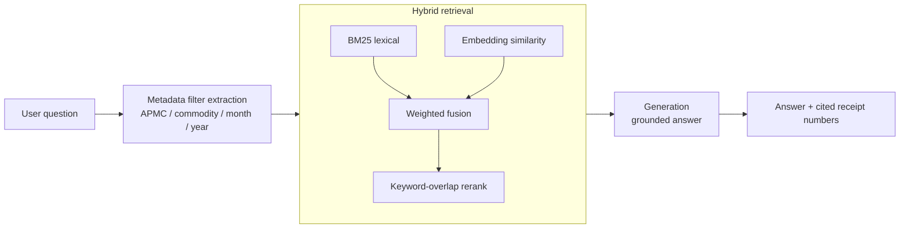

# APMC Market Intelligence Assistant

**Ask plain-English questions about agricultural auction data and get answers cited to the exact receipts they came from.**


## The problem

APMC (Agricultural Produce Market Committee) markets record every auction as a receipt: commodity, rate, weight, trader, date. Admins, traders and commission agents have to dig through those records by hand to answer simple questions such as *"What was the average onion rate at Manchar last month?"*. This project turns that receipt history into something you can query in natural language, with every answer traceable to source receipts.

> **Note:** this is a portfolio project inspired by APMC auction-digitization work in agritech. It runs entirely on **synthetic data** (180 generated receipts). No real farmer, trader or transaction data is included.

## How it works



Every swappable component picks the production tool if it is installed and configured, and otherwise falls back to a lightweight offline version, so the pipeline always runs:

| Layer | Production path | Offline demo (default) |
|---|---|---|
| Embeddings | Sentence-Transformers (`BAAI/bge-small-en-v1.5`) | TF-IDF (scikit-learn) |
| Lexical search | `rank_bm25` | Hand-written BM25 (`src/bm25.py`) |
| Vector store | In-memory | In-memory |
| Generation | OpenAI chat model (needs `OPENAI_API_KEY`) | Deterministic template computed from retrieved receipts |
| API | FastAPI | FastAPI |

In demo mode the answer is computed directly from the retrieved receipts' fields (average, range, total), so there is no free-text generation and nothing to hallucinate.

## Tech stack

Python, FastAPI, Pydantic, scikit-learn (TF-IDF), NumPy, optional Sentence-Transformers and OpenAI. `requirements.txt` also lists `qdrant-client`, `langchain` and `ragas` for the planned production path; they are not wired into the code yet.

## Getting started

Requires Python 3.10+.

```bash
git clone https://github.com/Ruturaj2472/APMC-RAG-Assistant.git
cd APMC-RAG-Assistant
python -m venv .venv && source .venv/bin/activate     # Windows: .venv\Scripts\activate
pip install -r requirements-demo.txt

python demo_cli.py            # run sample queries end to end
python -m src.evaluate        # run the retrieval evaluation
python -m pytest tests -v     # run the tests
```

Run the API:

```bash
uvicorn app:app --reload
# POST http://localhost:8000/ask   {"query": "What was the average onion rate at Manchar Krishi Utpanna Bazar Samiti?"}
# GET  http://localhost:8000/health
```

To use OpenAI for generation, copy `.env.example`, set `OPENAI_API_KEY` in your environment, and restart. Without a key the offline template is used automatically.

## Results

Offline evaluation on 15 generated test queries (`python -m src.evaluate`, `top_k=5`):

| Metric | Value |
|---|---|
| Context precision | 1.0 |
| Context recall | 0.546 |

Precision is perfect because metadata filtering does most of the work. Recall is lower because `top_k=5` returns at most 5 receipts, even when an APMC and commodity pair has more matches. This is a real trade-off: aggregate questions such as total value need a higher `top_k` or aggregation over all filtered receipts, not just the top few.

The ground truth comes from the synthetic data itself, so these numbers show the retrieval logic works on this dataset. They are not a benchmark on real market data.

## Project structure

```
app.py                  FastAPI app
demo_cli.py             CLI demo
data/generate_receipts.py   synthetic receipt generator
data/receipts.json          180 generated receipts
src/bm25.py             lexical search
src/embeddings.py       embeddings (BGE or TF-IDF fallback)
src/retriever.py        hybrid retrieval, filtering, reranking
src/llm_provider.py     generation (OpenAI or template fallback)
src/pipeline.py         orchestration
src/evaluate.py         precision/recall harness
tests/                  pipeline tests
```

## What I'd do next

- Aggregate over **all** filtered receipts for sum and average questions instead of only the top-k, which should lift recall on those queries.
- Wire in Qdrant and BGE embeddings, then compare against the TF-IDF baseline.
- Add LLM-judged faithfulness evaluation with RAGAS, and test on real (anonymised) data.

## Author

Built by [Ruturaj Pangavhane](https://github.com/Ruturaj2472), AI Engineer, Boston, MA.
