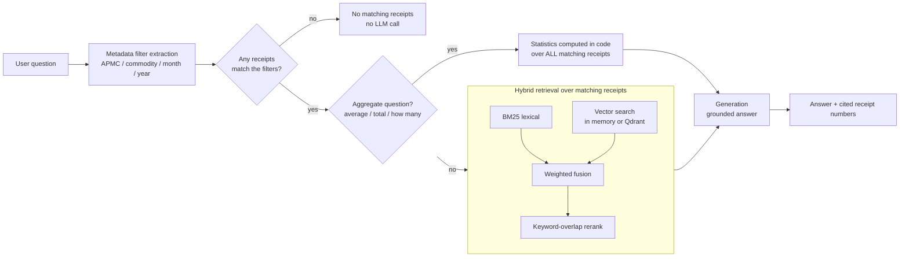

<h1 align="center">🌾 APMC Market Intelligence Assistant</h1>

<p align="center">
  <b>Ask plain-English questions about agricultural auction data and get answers cited to the exact receipts they came from, or an honest "no matching receipts" when the data isn't there.</b>
</p>

<p align="center">
  <a href="https://github.com/Ruturaj2472/APMC-RAG-Assistant/actions/workflows/tests.yml"></a>
  
  
  
  
  
  
  
</p>

<div align="center">

| 🎯 Retrieval precision | 🧮 Exact aggregates | 🧾 RAGAS faithfulness | 🛑 No match |
|:---:|:---:|:---:|:---:|
| **1.0** on 15 test queries | **15 / 15** averages correct | **0.967** (LLM-judged) | abstains, no LLM call |

</div>

---

## Contents

1. [The problem](#the-problem)
2. [See it in action](#see-it-in-action)
3. [How it works](#how-it-works)
4. [Why the answers can be trusted](#why-the-answers-can-be-trusted)
5. [Results](#results)
6. [Getting started](#getting-started)
7. [Testing and CI](#testing-and-ci)
8. [Tech stack](#tech-stack)
9. [Project structure](#project-structure)
10. [What I'd do next](#what-id-do-next)

---

## The problem

APMC (Agricultural Produce Market Committee) markets record every auction as a receipt: commodity, rate, weight, trader, date. Admins, traders and commission agents dig through those records by hand to answer simple questions such as *"What was the average onion rate at Manchar last month?"*

This project turns that receipt history into something you can query in natural language, with every answer traceable to source receipts. Numbers such as averages and totals are computed over **every** matching receipt, and when no receipt matches, the assistant **says so instead of guessing**. In market and tax reporting, a confident wrong number is worse than no number.

> **Note:** this is a portfolio project inspired by APMC auction-digitization work. It runs entirely on **synthetic data** (180 generated receipts for 2023). No real farmer, trader or transaction data is included.

---

## See it in action

**An aggregate question.** The average is computed over all 9 matching receipts, not just the top few retrieved:

```json
{
  "query": "What was the average onion rate at Manchar Krishi Utpanna Bazar Samiti?",
  "extracted_filters": { "apmc": "Manchar Krishi Utpanna Bazar Samiti", "commodity": "Onion" },
  "answer": "Based on 9 matching receipt(s) for Onion at Manchar Krishi Utpanna Bazar Samiti: average rate was Rs. 98.56 per unit (range: Rs. 62-120), total transaction value Rs. 29882.36. Source receipts: 08704230001, 08704230016, 08704230018, 08704230025, 08704230029 ....",
  "cited_receipts": ["08704230001", "08704230016", "08704230018", "..."],
  "num_matched": 9,
  "statistics": { "receipts": 9, "average_rate": 98.56, "min_rate": 62, "max_rate": 120, "total_amount": 29882.36 }
}
```

**A question the data can't answer** (there are no 2022 receipts). The assistant says so instead of answering from unrelated records:

```json
{
  "query": "What was the average onion rate at Manchar in 2022?",
  "extracted_filters": { "apmc": "Manchar Krishi Utpanna Bazar Samiti", "commodity": "Onion", "year": "2022" },
  "answer": "No matching receipts were found for apmc=Manchar Krishi Utpanna Bazar Samiti, commodity=Onion, year=2022.",
  "cited_receipts": [],
  "num_matched": 0
}
```

Both outputs come straight from `pipeline.ask(...)` in offline mode.

---

## How it works



1. **Filter extraction** pulls the APMC, commodity, month and year out of the question.
2. **Metadata filtering** narrows the 180 receipts to the ones that match. If none match, the pipeline stops and says so.
3. **Aggregate questions** ("average", "total", "how many", "highest", ...) get statistics computed in code over every matching receipt. The LLM only phrases the result; it never does the arithmetic.
4. **Other questions** go through hybrid retrieval: BM25 (exact terms such as commodity names) and vector similarity (meaning) are fused and the top candidates reranked.
5. **Generation** writes the answer from that context only and returns the receipt numbers it used.

Every swappable component uses the production tool when installed and configured, and otherwise a lightweight offline version, so the pipeline always runs:

| Layer | Options | Default | Switch |
|---|---|---|---|
| Embeddings | BGE (`BAAI/bge-small-en-v1.5`) or TF-IDF | BGE if `sentence-transformers` is installed, else TF-IDF | `EMBEDDINGS=bge` / `tfidf` |
| Vector store | In memory or **Qdrant** (local in-process mode, or a server via `QDRANT_URL`) with payload filters | In memory | `VECTOR_STORE=qdrant` |
| Lexical search | Hand-written BM25 (`src/bm25.py`) | | |
| Generation | OpenAI chat model, or a deterministic template computed from the receipts | OpenAI if `OPENAI_API_KEY` is set | `OPENAI_MODEL` |
| API | FastAPI | | |

---

## Why the answers can be trusted

| Safeguard | How |
|---|---|
| **Cited answers** | Every response returns `cited_receipts`, so each number can be traced back to source records. |
| **Exact aggregates** | Averages, totals, ranges and counts are computed in code over every receipt matching the filters and passed to the LLM as a statistics line. The LLM doesn't do arithmetic. |
| **Abstains on zero matches** | When the filters match no receipt, retrieval returns nothing and the pipeline answers *"No matching receipts were found for ..."* without calling the LLM. It never falls back to unrelated receipts. |
| **Grounded generation** | The OpenAI prompt restricts answers to the provided receipts. In offline mode the answer is computed directly from receipt fields, so there is no free text to hallucinate. |
| **Measured faithfulness** | RAGAS checks every claim in generated answers against the context the LLM was given. |
| **Regression tests in CI** | Zero-match behavior, aggregate correctness, filter correctness and the Qdrant integration are tested on every push. |

---

## Results

All numbers come from the synthetic dataset, whose ground truth is known exactly. They show the logic works on this data; they are not a benchmark on real market data.

### Retrieval (`python -m src.evaluate`, 15 queries, `top_k=5`)

| Metric | Value |
|---|---|
| Context precision | **1.0** |
| Context recall (top-5 retrieval) | 0.546 |

Precision is perfect because metadata filtering does most of the work. Top-5 recall is capped because an APMC and commodity pair often has more than 5 receipts, which is why aggregate questions don't rely on top-5 retrieval:

### Aggregate questions (same script, 15 APMC + commodity pairs)

| | Top-5 retrieved receipts only | All filtered receipts (current) |
|---|---|---|
| Average rate exactly correct | 0 / 15 | **15 / 15** |
| Receipts used (recall) | 0.546 | **1.0** |

### Embeddings and vector store (`python -m src.compare_retrieval`)

The evaluation above is dominated by metadata filters, so every embedder scores the same there. This benchmark uses 16 questions about fields the filters don't extract (commission agent, trader, payment mode, grade, village): 8 use the same words as the receipt text, 8 are paraphrases (e.g. *"deals settled electronically"* for Bank Transfer).

| Setup | Exact-term precision@5 | Paraphrase precision@5 | Overall precision@5 | Paraphrase hit@1 |
|---|---|---|---|---|
| BM25 only | **1.0** | 0.40 | 0.700 | 0.25 |
| BM25 + TF-IDF | 0.95 | 0.40 | 0.675 | 0.25 |
| BM25 + BGE (in memory) | 0.925 | **0.525** | **0.725** | **0.375** |
| BM25 + BGE (Qdrant) | 0.925 | **0.525** | **0.725** | **0.375** |
| BGE only (Qdrant) | 0.90 | 0.525 | 0.713 | 0.375 |

- **BGE lifts paraphrase precision from 0.40 to 0.525** and puts a relevant receipt first 50% more often, at a small cost on exact-term questions, which keyword matching already handles. That trade-off is why retrieval is hybrid.
- **Qdrant returns the same results as in-memory search** (verified by tests), with the APMC / commodity / date filters applied as Qdrant payload filters.
- Paraphrase scores are still modest; the keyword-overlap reranker is the likely limit (see next steps).

Full results: [`results/retrieval_comparison.json`](results/retrieval_comparison.json).

### LLM-judged faithfulness (`python -m src.evaluate_ragas`)

RAGAS 0.4 `Faithfulness`: the share of claims in each generated answer that are supported by the context given to the LLM. Generation and judge: `gpt-4o-mini`.

| Metric | Value |
|---|---|
| Mean faithfulness | **0.967** (10 answered questions) |
| Answers scoring 1.0 | 9 / 10 |
| Questions correctly abstained (no matching receipts) | 3 / 3 |

The one answer below 1.0 (0.667) is correct when checked against the data; it scored 1.0 in an earlier run, which reflects the variance of a small LLM judge. Full per-question results: [`results/ragas_faithfulness.json`](results/ragas_faithfulness.json).

---

## Getting started

Requires Python 3.10+.

```bash
git clone https://github.com/Ruturaj2472/APMC-RAG-Assistant.git
cd APMC-RAG-Assistant
python -m venv .venv && source .venv/bin/activate     # Windows: .venv\Scripts\activate
pip install -r requirements-demo.txt

python demo_cli.py               # run sample queries end to end
python -m src.evaluate           # retrieval + aggregate evaluation
python -m src.compare_retrieval  # embeddings / vector store comparison
python -m pytest tests -v        # run the tests
```

Run the API:

```bash
uvicorn app:app --reload
# POST http://localhost:8000/ask   {"query": "What was the average onion rate at Manchar Krishi Utpanna Bazar Samiti?"}
# GET  http://localhost:8000/health
```

Optional production components:

```bash
# BGE embeddings (downloads the ~130 MB model on first use)
pip install sentence-transformers

# Qdrant: local in-process mode needs no server
VECTOR_STORE=qdrant python demo_cli.py
# ...or point at a Qdrant server
docker run -p 6333:6333 qdrant/qdrant
VECTOR_STORE=qdrant QDRANT_URL=http://localhost:6333 python demo_cli.py

# OpenAI generation
export OPENAI_API_KEY=sk-...            # optional: OPENAI_MODEL=gpt-4o-mini

# RAGAS faithfulness evaluation (calls OpenAI, a few cents per run)
pip install -r requirements-eval.txt
python -m src.evaluate_ragas
```

Without an OpenAI key the offline template is used automatically.

---

## Testing and CI

GitHub Actions (`.github/workflows/tests.yml`) runs on every push and pull request: it installs the demo requirements (including `qdrant-client`), runs the test suite, and runs the retrieval evaluation. The RAGAS evaluation is run manually because it calls OpenAI.

| Test | Checks |
|---|---|
| `test_pipeline_loads_receipts` | The receipt data loads |
| `test_filter_extraction_apmc_and_commodity` | APMC and commodity are extracted from the question |
| `test_retrieval_returns_matching_commodity` | Retrieved receipts match the asked commodity |
| `test_no_filter_query_still_returns_results` | Questions without filters still search all receipts |
| `test_zero_match_filters_return_no_receipts` | A question with no matching receipts returns none and says so |
| `test_zero_match_does_not_fall_back_to_full_corpus` | Zero-match filters return an empty set, never the whole corpus |
| `test_zero_match_answer_does_not_call_the_llm` | No LLM call is made when nothing matches |
| `test_filtered_results_match_every_filter` | Every cited receipt matches all extracted filters |
| `test_average_question_uses_all_filtered_receipts` | Averages use every matching receipt and equal the true average |
| `test_total_question_matches_the_data` | Totals and counts equal the values computed from the data |
| `test_non_aggregate_question_keeps_top_k` | Lookup questions still use top-k retrieval |
| `test_qdrant_scores_match_in_memory_scores` | Qdrant similarity scores equal in-memory scores |
| `test_qdrant_payload_filter_returns_only_matching_receipts` | Qdrant payload filters return exactly the matching receipts |
| `test_qdrant_and_memory_retrieve_the_same_receipts` | Both vector stores retrieve the same receipts in the same order |
| `test_qdrant_zero_match_filters_return_nothing` | The zero-match guarantee holds with Qdrant too |

---

## Tech stack

Python, FastAPI, Pydantic, Qdrant (`qdrant-client`), Sentence-Transformers (BGE), scikit-learn (TF-IDF), NumPy, OpenAI, RAGAS (with `langchain-openai` as the judge wrapper), pytest, GitHub Actions.

---

## Project structure

```
app.py                       FastAPI app
demo_cli.py                  CLI demo
data/generate_receipts.py    synthetic receipt generator
data/receipts.json           180 generated receipts
src/bm25.py                  lexical search
src/embeddings.py            BGE or TF-IDF embeddings
src/vector_store.py          in-memory or Qdrant vector store
src/retriever.py             filter extraction, metadata filtering, hybrid retrieval, reranking
src/llm_provider.py          generation (OpenAI or template fallback)
src/pipeline.py              orchestration, exact aggregates, cited answers, zero-match abstain
src/evaluate.py              retrieval + aggregate evaluation
src/compare_retrieval.py     embeddings / vector store comparison
src/evaluate_ragas.py        RAGAS faithfulness evaluation
results/                     saved comparison and RAGAS results
tests/                       pipeline, regression and Qdrant tests
requirements-demo.txt        offline demo + tests
requirements-eval.txt        RAGAS evaluation (pinned)
.github/workflows/tests.yml  CI: tests + evaluation
```

---

## What I'd do next

- Replace the keyword-overlap reranker with a cross-encoder (e.g. `cross-encoder/ms-marco-MiniLM-L-6-v2`) and re-run the paraphrase benchmark, where the current reranker is the likely limit.
- Extract filters with an LLM structured-output call instead of regex, so phrasings like "last month" or "Manchar market" are understood.
- Evaluate on real (anonymised) receipt data, and use a stronger or repeated LLM judge to reduce RAGAS score variance.

---

## Author

Built by [Ruturaj Pangavhane](https://github.com/Ruturaj2472), AI Engineer, Boston, MA.
